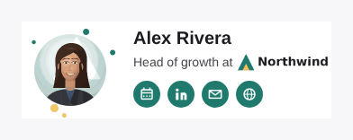
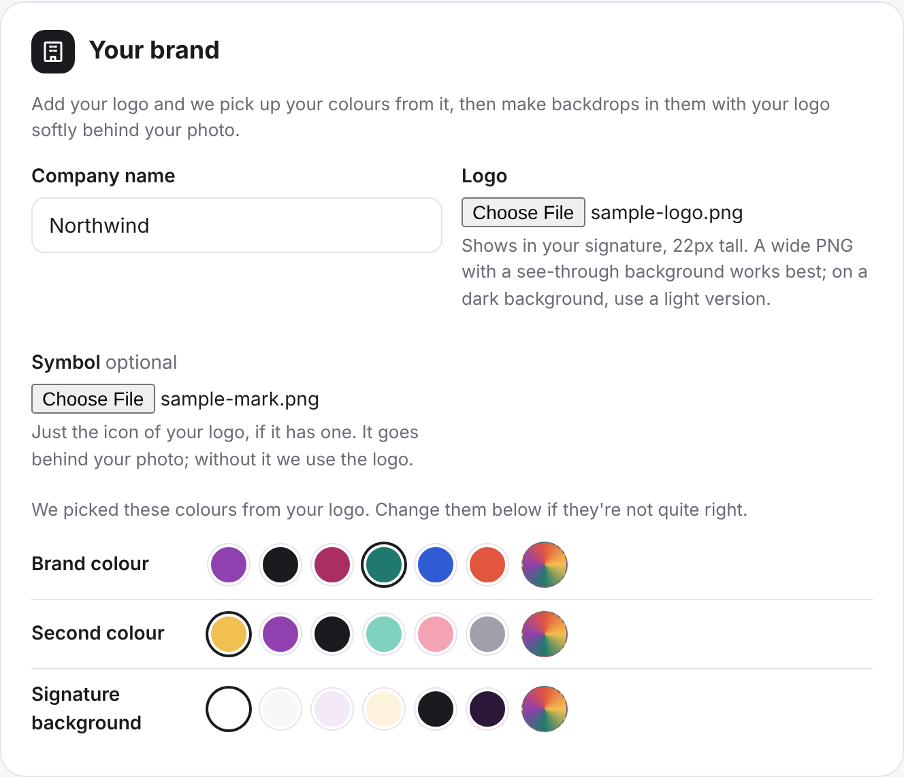
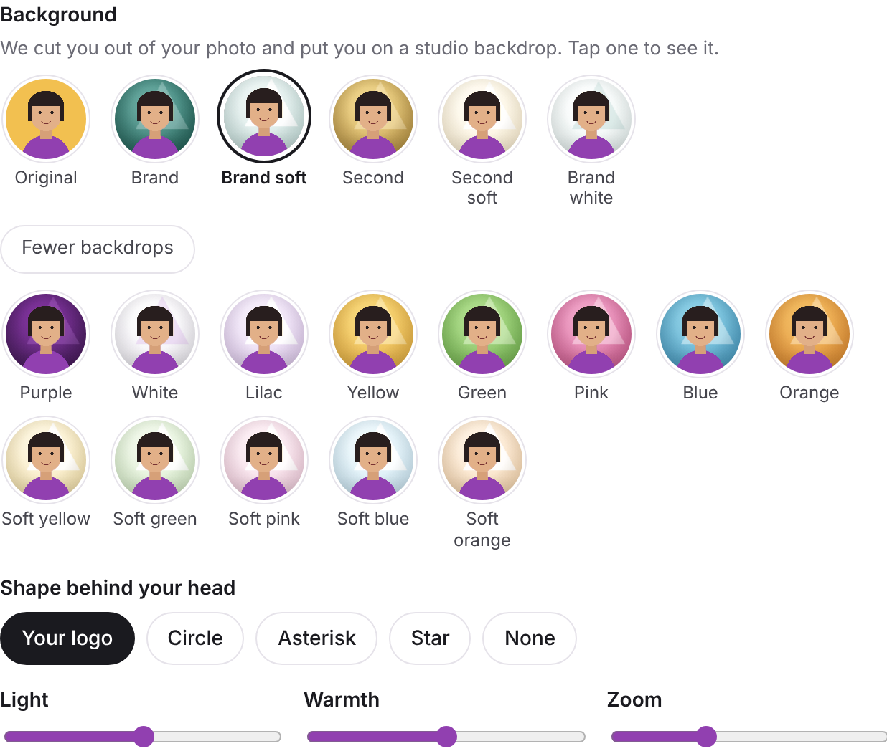
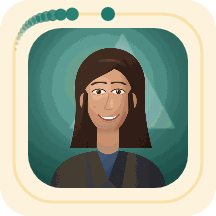
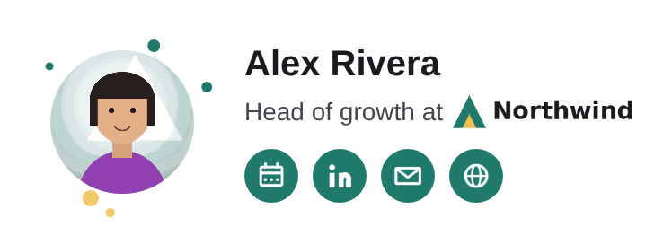
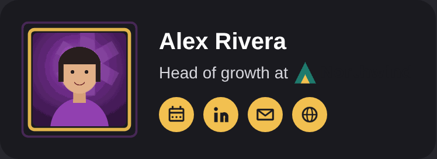
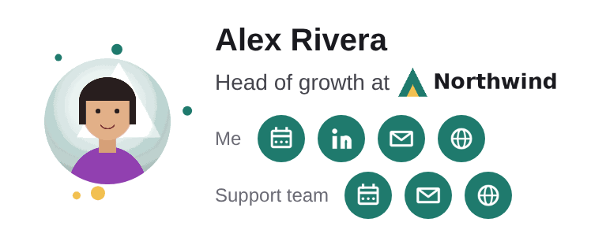
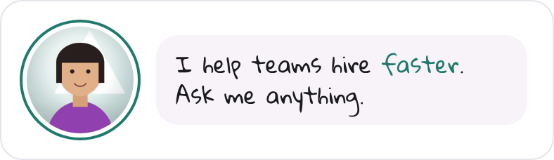
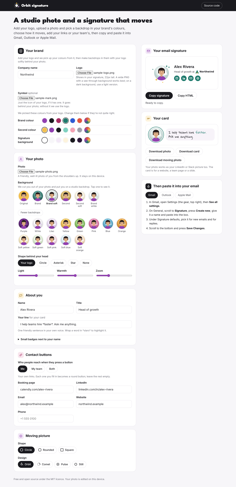

<p align="center"></p>

<h1 align="center">Orbit signature</h1>

<p align="center">
  <b>Upload a photo. Get a studio portrait and an email signature that moves.</b><br>
  Free and open source. The photo is edited in your browser; copy, paste, done.
</p>

<p align="center">
  <a href="https://github.com/tania-atomichr/orbit-signature/actions/workflows/test.yml"></a>
  <a href="LICENSE"></a>
  
  
</p>

<p align="center"></p>

## Why use it

| | |
|---|---|
| **A studio photo from any photo** | It cuts you out of your photo right in the browser and puts you on a studio backdrop, with a glow, a halo shape and a soft shadow. Every face is framed the same way, so a whole team matches. |
| **A signature that moves** | Your photo in a circle, a rounded square or a square, with dots orbiting, a comet running round, a pulse, or kept still. |
| **Your brand, not ours** | Add your logo and it picks up your colours, then makes studio backdrops in them with your logo softly behind your photo. A portal can lock the brand so every signature in the company matches. |
| **Copy and paste** | Run it with its small server, or inside your own portal, and the pictures are saved for you. Press **Copy signature** and paste it into Gmail, Outlook or Apple Mail. |
| **You or your team** | The buttons can reach you, your team (a shared support inbox, say) or both, while your name still signs the email. |
| **Private** | No account, no tracking, no other sites. Your photo is edited on your device; only the finished pictures are saved, and only where you run it. See [PRIVACY.md](PRIVACY.md). |
| **Easy to change** | Plain JavaScript, HTML and CSS. No build step, no dependencies. MIT licence. |

## Quick start

You need [Node.js](https://nodejs.org) 18 or newer.

```sh
git clone https://github.com/tania-atomichr/orbit-signature.git
cd orbit-signature
PUBLIC_URL=https://signature.your-company.com node server.mjs
```

Open http://localhost:8080. `PUBLIC_URL` is the address other people reach the server at: the pictures in every email point there, so it must be public (see [Run it for your team](#run-it-for-your-team)).

No server? Open `index.html` from any static host, such as GitHub Pages. Everything works the same, except that people download their pictures and host them themselves. [More on that below](#no-server-github-pages).

## Contents

- [What it makes](#what-it-makes): the photo, the signature, the card
- [Everything it does](#everything-it-does)
- [Run it for your team](#run-it-for-your-team) and [inside your own portal](#inside-your-own-portal)
- [No server (GitHub Pages)](#no-server-github-pages)
- [Privacy](#privacy), [How it is built](#how-it-is-built), [Test](#test)
- [Contributing](#contributing)

## What it makes

All pictures here are of a made-up person and company.

**Your brand.** Add your logo (and its symbol, if it has one). The page reads your colours off the logo; change them if they're not quite right.



**The studio photo.** Upload a photo; the page cuts you out and shows you on backdrops made from your brand: both colours, strong and soft, and a tinted white, with your symbol tone on tone behind your head. Thirteen ready-made backdrops are a press away. Touch up the light, warmth and zoom.



**The email signature**, in any of four designs, three shapes and your colours:

| Orbit | Comet | Pulse | Still |
|:---:|:---:|:---:|:---:|
|  |  |  |  |




**Who people reach.** The buttons can go to you, to your team, or both:



**Your card**: your photo and one line in your own voice, with a highlighted word. Download it for a website, a team page or a slide.



**The whole page**, at a desk and on a phone:

| | |
|:---:|:---:|
|  |  |

## Everything it does

**Your brand**
- Upload your logo and, if it has one, its symbol.
- Your brand colour and a second colour are read off the logo (the most used colourful shade, then one of a clearly different hue); change either, or pick from presets.
- The signature's background colour, from presets or your own.

**Photo studio**
- Cuts you out of the photo in the browser with a small model (U²-Net, 4.5 MB): soft hair edges, the old wall's colour taken out of the edges, and anything that isn't you (a chair, a lamp) dropped.
- Frames you by your head, so every face sits in the same place.
- Backdrops made from your brand: brand and second colour, each strong and soft, and a white tinted with your brand.
- 13 ready-made backdrops too (purple, white, lilac, yellow, green, pink, blue, orange and five soft ones), or keep the original.
- Each backdrop has a glow behind your head, your symbol or logo tone on tone behind it (or a circle, asterisk, star, or nothing), light pooled behind you with the corners in shade, and a soft shadow as from a window.
- Touch-ups: light, warmth and zoom.
- Download the photo for LinkedIn, Slack or anywhere else.

**Email signature**
- The moving photo: orbit, comet, pulse or still, in a circle, rounded square or square, made in the browser as a GIF of about 50 to 90 KB.
- Name, title, and company as a name or your logo.
- Round buttons for a booking page, LinkedIn, email, website and phone, in your brand colour, with icons that stay readable on light and dark colours.
- Buttons that reach you, your team, or both rows, labelled.
- Up to three small badges next to your name, linking to one page.
- Built for inboxes: tables and inline styles only, Arial, PNG icons (Gmail drops SVG), alt text on every picture, and a plain-text copy for mail set to plain text.
- **Copy signature**, **Copy HTML**, and steps for Gmail, Outlook and Apple Mail.

**Card**
- Your photo with a ring on pale backdrops, and your line in a speech bubble with a *highlighted* word.
- Download it as a picture.

**For teams and portals**
- One file decides where pictures are kept ([`src/storage.js`](src/storage.js)); swap it for your own storage.
- Fill in the person's details from your portal and lock the company's look ([`src/config.js`](src/config.js)).
- A ready-made server with an optional team key.
- Remembers the form and the photo in the browser, so a reload keeps the work.

## Run it for your team

`server.mjs` serves the page and keeps the pictures, so people only copy and paste. It has no dependencies.

| Setting | What it does | Default |
|---|---|---|
| `PUBLIC_URL` | The address people reach it at. Pictures in emails point here. | the address in the request |
| `PORT` | Port to listen on. | `8080` |
| `DATA_DIR` | Where pictures are kept. Use a disk that survives restarts. | `./data` |
| `UPLOAD_KEY` | Optional. A shared key people enter once before saving pictures. | none |

With Docker:

```sh
docker build -t orbit-signature .
docker run -p 8080:8080 -v orbit-data:/app/data -e PUBLIC_URL=https://signature.your-company.com orbit-signature
```

Any host that runs Node or Docker and keeps a disk works (Render with a disk, Fly.io with a volume, a small VPS).

What the server does and does not do:

- It takes pictures only (GIF, PNG, JPEG, WebP, checked by their first bytes), up to 1 MB, and at most 60 an hour from one address.
- Each picture is named by its own content, so an address can't be guessed or overwritten, and the same picture twice is one file.
- It serves the page's own files and the pictures, nothing else from the folder.
- It keeps no names, emails or form data. Pictures are kept until you delete them from `DATA_DIR`.

## Inside your own portal

The page is plain files, so a portal can serve them from its own pages. Two files are meant to be changed:

**Where pictures go: [`src/storage.js`](src/storage.js).** `savePicture(blob)` must store the picture somewhere public and return its address. The default posts it to `api/images`; point it at your own API, S3 or R2:

```js
export async function savePicture(blob) {
  const res = await fetch("/my-portal/api/signature-pictures", { method: "POST", body: blob });
  return (await res.json()).url;   // a public https:// address
}
```

**Who is signing, and your brand: [`src/config.js`](src/config.js)**, or set `window.ORBIT_SIGNATURE` before the page's script:

```html
<script>
  window.ORBIT_SIGNATURE = {
    storage: "/my-portal/api/signature-pictures",
    person: { name: "Alex Rivera", title: "Head of growth", email: "alex@northwind.example" },
    team: { name: "Support team", email: "support@northwind.example" },
    brand: { company: "Northwind", logo: "https://cdn.northwind.example/logo.png",
             mark: "https://cdn.northwind.example/symbol.png", accent: "#1f7a6d", second: "#f2c050" },
    locked: ["company", "logo", "accent"],
  };
</script>
<script type="module" src="/signature/src/app.js"></script>
```

`locked` fields are shown but can't be changed, so every signature in the company matches. A logo or symbol on another site needs CORS (`Access-Control-Allow-Origin`) for the page to read its colours and draw it behind the photo.

## No server (GitHub Pages)

The page works as plain files too, but it then has nowhere to keep pictures, and mail apps load pictures from the web. People press **Download moving photo**, put it somewhere public, and paste its address under **Pictures on the web**. The page says so until they do.

1. Fork this repository.
2. In your fork, open **Settings → Pages**, choose **Deploy from a branch**, pick `main` and `/ (root)`, and save.
3. Open `https://<your-username>.github.io/orbit-signature/`. The icons' address fills itself in.
4. Add your moving photo to the fork (for example `photos/alex.gif`) and paste `https://<your-username>.github.io/orbit-signature/photos/alex.gif`.

## Privacy

- Your photo is cut out and edited **on your device**. The original never leaves it.
- What leaves the browser: the finished moving photo and your logo, and only to the storage this page is set up with. Nothing else, and nothing when there is no storage.
- The form and photo are remembered in your browser's local storage. Clear the site's data to forget them.
- The page loads nothing from other sites: fonts, the model and its runtime are all in this repository.

Full details in [PRIVACY.md](PRIVACY.md).

## How it is built

```
index.html          the page
src/app.js          the form, the preview, copying
src/studio.js       cut-out, backdrops, halo, light, shadow, touch-ups
src/orbit.js        the moving picture (four designs, three shapes)
src/signature.js    the signature's HTML and plain text
src/storage.js      where pictures go (swap this)
src/config.js       person, team, brand, locked fields (set this)
server.mjs          the optional server
icons/              the button icons, light and dark
vendor/, fonts/     third-party files, see vendor/README.md
```

Mail apps keep very little: tables, inline styles, web-safe fonts and PNG or GIF pictures at public addresses. Everything the signature does is built from those. The button colour is the table cell's background, so one set of icons works for any brand colour. Outlook on Windows shows square buttons, because it ignores rounded corners. It also shows only the first frame of a moving picture (true of every animated signature), so the first frame is drawn to look finished on its own.

## Test

```sh
npm install
npx playwright install chromium
npm test
```

`test/unit.mjs` checks the signature builder: escaping, unsafe links, colours, team buttons. `test/e2e.mjs` drives the real page in Chromium, with its server and as plain files: cutting out a photo, every backdrop, design and shape, saving pictures, copying, a portal's settings, the server's limits, and no sideways scroll at 1280 or 390 pixels wide.

`node scripts/docs.mjs && python3 scripts/demo_gif.py` remakes the pictures in `docs/`.

**Not covered by the tests:** how the pasted signature looks in each mail app, and browsers other than Chromium (Safari, Firefox). Reports are welcome.

## Contributing

Bug reports, ideas and pull requests are welcome. Read [CONTRIBUTING.md](CONTRIBUTING.md) first, and report security problems privately as described in [SECURITY.md](SECURITY.md).

## Licence

MIT. See [LICENSE](LICENSE). Third-party files keep their own licences, listed in [vendor/README.md](vendor/README.md).
